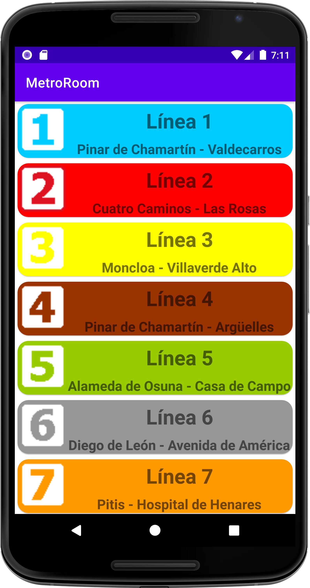
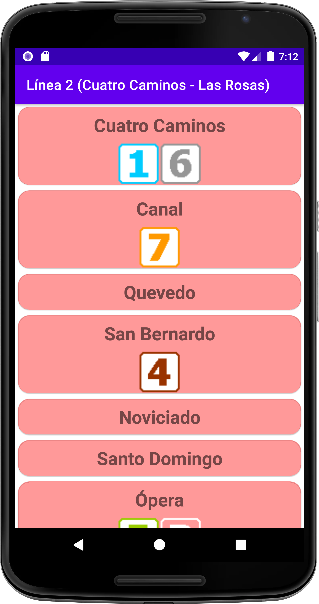
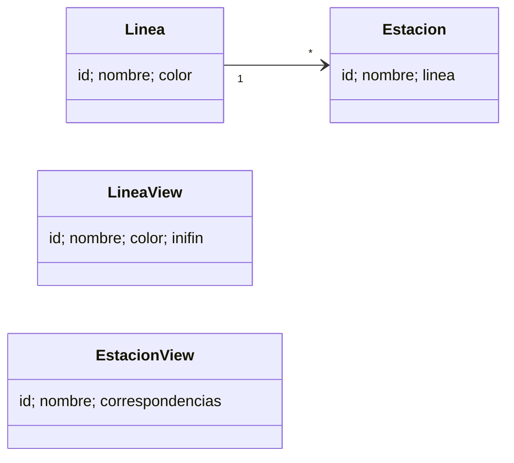

# 🚇 Madrid Metro — Lines and Stations Guide (Kotlin + Android)

An Android app to **browse the Madrid Metro network**. It lists every line with its terminal stations, shows all the stations of a line in order and displays the **lines you can transfer to** at each one. It works fully offline.

> 🎓 **Academic project.** Built for the **Multimedia Programming and Mobile Devices** module (*Programación Multimedia y Dispositivos Móviles, PMDM*) of the **Higher Vocational Degree in Multiplatform Application Development** (*CFGS Desarrollo de Aplicaciones Multiplataforma, DAM*), 2nd year.

---

## 📸 Screenshots

| Lines | Stations |
|---|---|
|  |  |

---

## ✨ Features

- **Offline database** with **16 lines** (Lines 1–12, Light Metro 1–3 and the Ramal branch) and **326 stations**, available from the first launch.
- **Lines list**: each line shows its icon, its name, the stations at both ends (for example *Pinar de Chamartín - Valdecarros* for Line 1) and its **official colour**.
- **Stations of a line**, in order from one end to the other.
- **Transfers**: each station shows the **icons of the other lines** that stop there.
- Station cards use a **softer version of the line colour**, so the text stays readable.

---

## 🧰 Tech Stack

| Layer | Technology |
|---|---|
| Language | **Kotlin** |
| Platform | Android (minSdk 21, targetSdk 32) |
| Persistence | **Room** (SQLite) with `@Entity`, `@Dao` and custom `@Query` |
| Architecture | **MVVM**: `ViewModel` + `LiveData` + Repository |
| Async | Kotlin Coroutines |
| UI | `RecyclerView`, `CardView` |
| IDE / build | Android Studio (Gradle) |

---

## 🏗️ Architecture

| Screen | Responsibility |
|---|---|
| `MainActivity` | Copies the database on first launch and lists the lines. |
| `EstacionesActivity` | Shows the stations of a line and the transfers of each one. |

### Implementation details

- **Pre-filled database**: `MetroDB.db` ships in `assets/` and `Util.inyecta()` copies it to the app's databases folder the first time the app runs, so Room opens it ready to use.
- **Line terminals with one query**: `LineaDao` finds the first and last station of each line with `min(id)` / `max(id)` and joins them into a `LineaView` with a text such as `Station A - Station B`.
- **Transfers**: a station that belongs to several lines appears once per line in the database, with the same name. `getCorrespondencias()` looks for the other lines with that name and the adapter draws one icon per line.
- **Off the main thread**: the transfers of every station are loaded from a coroutine, which switches back to the main thread to update the list.
- **Dynamic drawables**: line icons are named `icono_linea_<id>` and loaded at runtime with `resources.getIdentifier()`.

### Domain model



---

## 📁 Project Structure

```
madrid-metro-room/
├── app/src/main/
│   ├── java/net/azarquiel/metroroom/
│   │   ├── adapters/          # Lines and stations RecyclerView adapters
│   │   ├── model/             # Room entities, DAOs, database and repositories
│   │   ├── util/Util.kt       # Copies the database from assets
│   │   ├── viewmodel/         # ViewModels
│   │   └── views/             # Activities
│   ├── assets/MetroDB.db
│   └── res/                   # Layouts, line icons and values
├── screenshots/
└── build.gradle / settings.gradle
```

---

## 🚀 Running Locally

**No internet or backend needed.** The whole network is stored in the app.

### Prerequisites
- Android Studio
- Android SDK 32
- An emulator or an Android device (Android 5.0+)

### Steps
1. Clone the repository:
   ```bash
   git clone https://github.com/ivangomezr/madrid-metro-room.git
   ```
2. Open the project in Android Studio and let Gradle sync.
3. Press **Run ▶** and choose an emulator or a connected device.

> ℹ️ The data reflects the network at the time the project was made, so new stations or lines may be missing.

---

## 🙋 Author

**Iván Gómez** — [@ivangomezr](https://github.com/ivangomezr)

Developed as coursework for the *Multimedia Programming and Mobile Devices* module, DAM.
